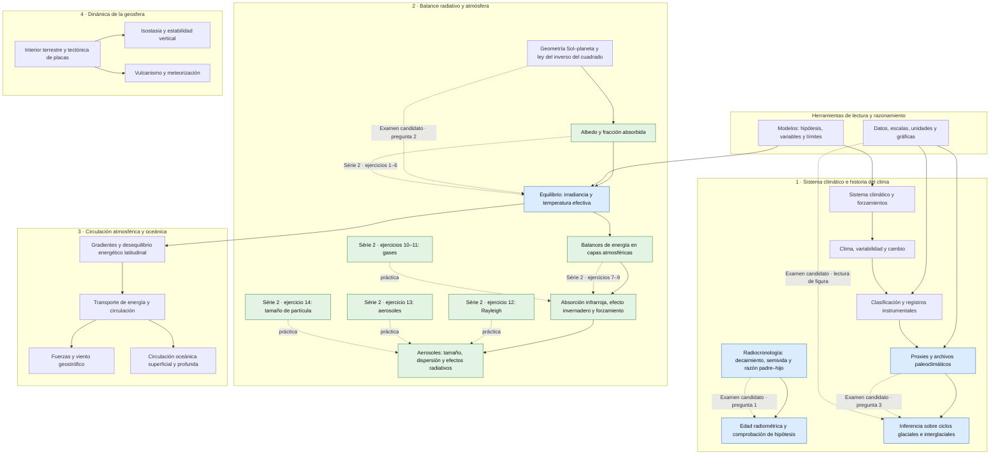

# Preparación del examen — Terra, Ambiente e Clima


La asignatura evalúa un recorrido que va desde los registros climáticos y su cronología hasta los balances de energía, la circulación y la geodinámica. La [ficha curricular oficial de FCUL](https://fenix.ciencias.ulisboa.pt/degrees/fisica-564500436615320/disciplina-curricular/283205848531351) contempla examen final o dos pruebas intermedias; el temario incluye los cuatro bloques que enlaza el [[Física/Grado/1º/Terra, Ambiente e Clima/Terra, Ambiente e Clima — índice de contenidos|índice curricular]].

## Qué permite afirmar la evidencia disponible

### Un examen anterior, tres preguntas visibles

La única copia de examen anterior que se ha podido localizar y revisar es una reproducción estudiantil atribuida a la época normal del 13 de enero de 2016. La ficha de Studocu la cataloga como material de estudiante y muestra metadatos académicos que no coinciden del todo con el encabezado del documento. Conviene tratarla como **copia candidata**, no como archivo oficial autenticado. Su cuerpo termina en «Fim do documento» tras tres preguntas. La vista previa muestra fragmentos después de ese cierre, pero no permite atribuirlos a esta copia; por eso quedan fuera del análisis ([copia candidata de 2016 en Studocu](https://www.studocu.com/pt/document/universidade-de-lisboa/terra-ambiente-e-clima/tac-2015-2016-exame-a-13-janeiro-2016/2097100)).

> [!definicion] Alcance de la evidencia de examen
> Se define la **frecuencia observada** de un tema o formato como su número de apariciones en un conjunto de exámenes auténticos cuyo contenido se ha revisado. Una sola copia candidata permite describir asociaciones en esa muestra; no permite inferir recurrencia entre años ni calcular una frecuencia representativa (véase la [copia candidata de 2016 en Studocu](https://www.studocu.com/pt/document/universidade-de-lisboa/terra-ambiente-e-clima/tac-2015-2016-exame-a-13-janeiro-2016/2097100)).

En esos tres bloques de pregunta sí se observan estos desempeños:

1. **Radiocronología:** representar el decaimiento a lo largo de cuatro semividas y deducir el tiempo transcurrido a partir de la razón entre isótopo padre e hijo.
2. **Balance solar:** deducir la irradiancia a la distancia orbital y la temperatura efectiva planetaria, dibujar la geometría y declarar tres hipótesis.
3. **Interpretación de una figura:** contar y fechar intervalos glaciales e interglaciales en una serie de 450 ka, explicar los mecanismos forzadores y relacionar el polvo con los máximos glaciales ([copia candidata de 2016 en Studocu](https://www.studocu.com/pt/document/universidade-de-lisboa/terra-ambiente-e-clima/tac-2015-2016-exame-a-13-janeiro-2016/2097100)).

El corpus de exámenes revisado tiene $n=1$: una copia candidata con tres bloques de pregunta. Esto describe lo que aparece en esa muestra; no estima qué pregunta «más» el profesor. No permite asignar porcentajes, jerarquizar capítulos por frecuencia ni afirmar que esos formatos se repitan cada año. Tampoco se ha recuperado el resultado del chat anterior «Buscar exámenes anteriores»: el historial disponible no expone su respuesta ni sus fuentes.

```anki
deck: Física::Terra, Ambiente e Clima::Preparación de examen
tags:
  - fcul
  - evidencia-de-examen
---
> [!note] Pregunta
> ¿Qué permite concluir una única copia candidata sobre la frecuencia de un tipo de pregunta?
===
> [!important] Respuesta
> Permite describir lo que aparece en esa copia; no permite estimar recurrencia entre años ni calcular una frecuencia representativa.
```

### Calendario docente reciente: secuencia, no contenido de examen

En 2025/26, [los sumarios de Fenix](https://fenix.ciencias.ulisboa.pt/courses/tacli-2817829258658062/sumarios) registran el primer test el 22 de octubre, después del trabajo de balance radiativo y la resolución de la Série 2; circulación empieza en los sumarios posteriores. El segundo test figura el 10 de diciembre, tras los contenidos de geosfera y la Série 4. Esto muestra cómo se distribuyeron esos dos tests ese año, pero el calendario no publica sus enunciados y no demuestra qué temas aparecieron en ellos.

### Prácticas disponibles: patrones de entrenamiento, no frecuencia de examen

La *Série Nº 1* practica lectura de series y anomalías, clasificación, proxies, correlación de anillos y cálculos de radiocronología, como muestran sus [[01 Ejercicios resueltos — Sistema climático y registro del clima|ejercicios resueltos]]. La *Série Nº 2* contiene catorce problemas: los ejercicios 1–6 aplican irradiancia, distancia, albedo y temperatura efectiva; 7–9 plantean balances de una o dos capas; 10–11 piden explicar gases de efecto invernadero y gases mayoritarios, 12 trata la dispersión de Rayleigh, 13 el efecto radiativo de aerosoles y 14 calcula un parámetro de tamaño de partículas. La [[Física/Grado/1º/Terra, Ambiente e Clima/02 Ejercicios resueltos — Balance radiativo y atmósfera|resolución de la Série Nº 2]] desarrolla estos formatos. Son una señal útil de los métodos que el curso hace practicar, pero no equivalen a exámenes ni autorizan a inferir su frecuencia en ellos.

## Grafo de dependencias y evidencia

Las flechas muestran **dependencias para comprender o resolver**: se lee desde las herramientas previas hacia tareas más integradoras. Las etiquetas en azul indican contenido que aparece en la copia candidata de 2016; las verdes, familias practicadas en la Série Nº 2. La ruta curricular hacia circulación y geosfera está en el programa; la copia candidata revisada solo permite atribuir evidencia a las preguntas de radiocronología, balance solar e interpretación paleoclimática.



**Leyenda:** azul = relación con las preguntas visibles de la copia candidata; verde = relación con ejercicios de la Série Nº 2; flecha continua = dependencia curricular inferida al organizar los prerrequisitos.

El grafo no afirma que las flechas sean precedencias temporales exactas ni que cada tema se evalúe siempre junto al siguiente. Resume relaciones de aprendizaje entre los bloques del programa; las líneas discontinuas identifican únicamente los vínculos respaldados por la copia candidata o por la práctica citada.

## Cómo preparar cada tipo de pregunta

### Ejemplo trabajado: deducir la temperatura efectiva

Escribe primero el sistema y el balance que conserva la magnitud. Antes de sustituir números, declara geometría, unidades e hipótesis. Después despeja, comprueba dimensiones y comenta qué cambiaría si se modificase un parámetro.

Para la temperatura efectiva, un planeta de radio $r_p$, albedo $\alpha_p$, irradiancia normal $S_0$ y emisión de cuerpo negro uniforme intercepta potencia sobre un disco y emite sobre una esfera. En equilibrio:

$$
S_0(1-\alpha_p)\,\pi r_p^2 = 4\pi r_p^2\sigma T_e^4,
\qquad
T_e=\left(\frac{S_0(1-\alpha_p)}{4\sigma}\right)^{1/4}.
$$

Aquí $S_0$ se mide en $\mathrm{W\,m^{-2}}$, $r_p$ en m, $\alpha_p$ es adimensional y $\sigma$ es la constante de Stefan–Boltzmann; $T_e$ se expresa en K. El radio se cancela porque tanto la potencia interceptada como la emitida son proporcionales a $r_p^2$. Puede presentarse en tres hipótesis operativas: **(1)** la radiación solar llega en rayos prácticamente paralelos y con irradiancia uniforme sobre el disco; **(2)** el planeta se resume en un albedo único y emite como cuerpo negro; **(3)** está en equilibrio radiativo y se representa su emisión con una temperatura efectiva uniforme. El modelo omite la distribución local de temperatura, la atmósfera y el transporte de energía; por eso $T_e$ no es, en general, la temperatura superficial. La [copia candidata de 2016](https://www.studocu.com/pt/document/universidade-de-lisboa/terra-ambiente-e-clima/tac-2015-2016-exame-a-13-janeiro-2016/2097100) pide identificar tres hipótesis; la misma derivación está desarrollada en [[Física/Grado/1º/Terra, Ambiente e Clima/02 Balance radiativo y atmósfera#Del Sol a la temperatura efectiva|la nota de balance radiativo]].

### Lectura e interpretación de figuras

Separa tres actos que a menudo se confunden: **leer** qué variable y unidad representa cada eje; **describir** qué cambia y cuándo; **explicar** qué mecanismo podría producir el patrón. Una correlación visible entre temperatura, CO₂ y polvo no basta por sí sola para asignar causalidad. Para responder con precisión, cita intervalos o rasgos de la figura y distingue el dato mostrado de la interpretación física que propone el modelo. La pregunta paleoclimática de la copia exige justamente contar y fechar intervalos, proponer mecanismos forzadores y explicar los máximos de polvo. Como la figura no puede leerse en la vista disponible, no se asignan un recuento ni fechas concretas (véase la [copia candidata de 2016 en Studocu](https://www.studocu.com/pt/document/universidade-de-lisboa/terra-ambiente-e-clima/tac-2015-2016-exame-a-13-janeiro-2016/2097100)).

### Problema radiométrico

Define $N$ como los núcleos padre que quedan, $N_R$ como los núcleos hijo radiogénicos acumulados y $\lambda$ como constante de desintegración. Si se supone que inicialmente no había hijo radiogénico (o que su cantidad inicial se ha corregido) y que el sistema ha permanecido cerrado:

$$
N=N_0e^{-\lambda t},\qquad N_0=N+N_R,
\qquad t=\frac{1}{\lambda}\ln\!\left(1+\frac{N_R}{N}\right).
$$

El argumento del logaritmo es adimensional y positivo; $\lambda$ debe expresarse en la inversa de la unidad de tiempo buscada. Si $N_R=N$, entonces $t=\ln2/\lambda$, una semivida. Este caso límite comprueba el álgebra y ayuda a detectar la inversión errónea del cociente. La copia candidata solicita derivar esta relación desde la ley exponencial y representar cuatro semividas (véase la [copia candidata de 2016 en Studocu](https://www.studocu.com/pt/document/universidade-de-lisboa/terra-ambiente-e-clima/tac-2015-2016-exame-a-13-janeiro-2016/2097100)).

## Práctica graduada con solución

Intenta cada apartado en una hoja aparte antes de leer su resolución. Los dos primeros reproducen las operaciones conceptuales observadas en la muestra candidata; los siguientes preparan los formatos presentes en las series. Las soluciones son modelos de razonamiento, no respuestas oficiales del profesor.

### Soluciones razonadas

#### 1. Reconocer la estructura de una pregunta

**Enunciado.** Una pregunta da $L_\odot$ y una distancia media $d$, y pide obtener la constante solar en la órbita de un planeta. ¿Qué ley usarías y qué magnitud geométrica describe?

**Solución razonada.** La energía del Sol se distribuye sobre una esfera de radio $d$, cuya superficie es $4\pi d^2$. Por tanto, la irradiancia es $S_0=L_\odot/(4\pi d^2)$. Sus unidades son $\mathrm{W\,m^{-2}}$. Si $d$ se duplica manteniendo constante la luminosidad, $S_0$ se divide por cuatro, comprobación directa de la dependencia inversa con el cuadrado de la distancia. Para continuar hacia $T_e$, se necesita además el albedo y el balance entre área interceptora y emisora.

#### 2. Deducir y validar una expresión

**Enunciado.** Parte de la potencia absorbida y emitida por el planeta para deducir $T_e$. Explica por qué desaparece el radio y predice qué ocurre si aumenta el albedo.

**Solución razonada.** La potencia absorbida es $(1-\alpha_p)S_0\pi r_p^2$; la emitida es $4\pi r_p^2\sigma T_e^4$. Igualarlas y despejar da $T_e=[S_0(1-\alpha_p)/(4\sigma)]^{1/4}$. El radio desaparece al cancelarse el factor $\pi r_p^2$. Como $T_e\propto(1-\alpha_p)^{1/4}$, elevar el albedo reduce la temperatura efectiva. La cuarta raíz muestra que una variación porcentual del flujo no produce la misma variación porcentual de temperatura. La respuesta no debe llamar a $T_e$ temperatura media superficial.

#### 3. Interpretar un archivo climático

**Enunciado.** En una figura de varios ciclos glaciales aparecen anomalías de temperatura, CO₂ y polvo. Escribe un esquema de respuesta que evite convertir la correlación en una afirmación causal automática.

**Solución razonada.** Primero se leen unidades, escala temporal y leyenda; después se cuentan y localizan los máximos y mínimos que la propia figura permite distinguir. A continuación se describe qué variables coinciden en los intervalos fríos y cálidos. Por último se separan mecanismos posibles de observaciones: la pregunta candidata solicita explicar los forzamientos glacial–interglacial y el polvo elevado en máximos glaciales, pero una respuesta completa debe vincular cada explicación a los rasgos del gráfico y a los mecanismos estudiados, sin atribuir al gráfico una prueba causal que no contiene (véase la [copia candidata de 2016 en Studocu](https://www.studocu.com/pt/document/universidade-de-lisboa/terra-ambiente-e-clima/tac-2015-2016-exame-a-13-janeiro-2016/2097100)).

#### 4. Transferir a un modelo de capas

**Enunciado.** Un planeta recibe el mismo flujo solar, pero se representa la atmósfera con una capa opaca al infrarrojo que absorbe y emite radiación. Antes de calcular, indica qué ecuaciones de balance habría que plantear.

**Solución razonada.** Se escriben balances separados para la superficie, la capa atmosférica y el tope de la atmósfera. Cada balance iguala entradas y salidas en equilibrio; se especifica que la capa es transparente a la radiación solar y opaca a la infrarroja terrestre. Se conserva el flujo solar medio absorbido del modelo planetario y se añaden las emisiones infrarrojas de la superficie y de la capa hacia arriba y abajo. No se debe reutilizar directamente $T_e$ como $T_s$: $T_e$ fija la emisión al espacio y el modelo de capas permite que la superficie tenga otra temperatura. La Série Nº 2 practica balances de una capa, dos capas y opacidad parcial.

## Límites de validez y errores de lectura

- **Muestra pequeña:** una copia candidata sirve para reconocer tareas que han aparecido, no para estimar qué suele repetirse. No conviertas tres bloques de una única prueba en porcentajes ni en un pronóstico anual.
- **Autenticidad y alcance:** la copia procede de una plataforma estudiantil. Su propio encabezado termina en «Fim do documento»; cualquier fragmento posterior queda sin atribuir porque la vista previa no permite establecer su relación con el archivo.
- **Modelo radiativo:** la fórmula de $T_e$ presupone equilibrio, una irradiancia solar promediada y un planeta simplificado con un albedo y una emisión efectivos. No se interpreta como temperatura superficial ni se transfiere sin cambios a un modelo con atmósfera.
- **Lectura de figuras:** correlación, secuencia temporal y mecanismo causal son afirmaciones distintas. Cita lo que muestran los ejes antes de explicar un mecanismo.

## Prioridad de estudio sin fingir una frecuencia

La muestra justifica dar práctica explícita a tres acciones: **derivar**, **declarar hipótesis** e **interpretar una figura**. Las series justifican preparar, además, cálculo de flujos y temperaturas, planteamiento de balances, explicaciones breves y clasificación de mecanismos de dispersión. Ninguna de esas observaciones permite concluir que haya que abandonar circulación o geosfera: ambas forman parte del programa oficial y del calendario de evaluación reciente.

Una secuencia eficiente es:

1. Repasar la nota curricular del bloque y anotar en una línea qué variable se conserva, qué modelo se usa y bajo qué hipótesis.
2. Resolver primero sin mirar el solucionario los problemas de la Série Nº 1 y Nº 2 enlazados abajo.
3. Corregir cada error por tipo: lectura de ejes, elección de modelo, álgebra, unidades, hipótesis o interpretación.
4. Volver a los problemas fallados unas horas o un día después, comenzando por reproducir el razonamiento y no por releer la respuesta.
5. Cerrar cada sesión con una explicación oral breve: pregunta, principio físico, pasos y límite del resultado.

**Control de inicio:** elige una derivación, una figura o un balance; formula los datos, incógnitas y criterio de comprobación antes de abrir apuntes. **Control de cierre:** explica sin consultar qué hipótesis hicieron posible el resultado, comprueba unidades y signo, y señala qué parte es dato y cuál interpretación. Este protocolo organiza el trabajo; no pretende estimar probabilidades de examen.


## 📚 Fuentes

### Material base local

- [[01 Sistema climático y registro del clima|Sistema climático y registro del clima]], incluida la práctica graduada y la sección de radiocronología.
- [[Física/Grado/1º/Terra, Ambiente e Clima/02 Balance radiativo y atmósfera|Balance radiativo y atmósfera]], para la derivación de la temperatura efectiva, los modelos de capas y los límites del balance radiativo.
- [[Física/Grado/1º/Terra, Ambiente e Clima/03 Circulación atmosférica y oceánica|Circulación atmosférica y oceánica]] y [[Física/Grado/1º/Terra, Ambiente e Clima/04 Dinámica de la geosfera|Dinámica de la geosfera]], para el recorrido curricular de los capítulos 3 y 4.
- [[01 Ejercicios resueltos — Sistema climático y registro del clima|Ejercicios resueltos — Sistema climático y registro del clima]], con los enunciados de la Série Nº 1 y soluciones razonadas.
- [[Serie_2.pdf|Série Nº 2: enunciados originales]], junto con [[Física/Grado/1º/Terra, Ambiente e Clima/02 Ejercicios resueltos — Balance radiativo y atmósfera|los ejercicios resueltos]], que desarrolla los catorce problemas con soluciones razonadas.

### Fuentes oficiales y examen candidato

- [Ficha curricular de Terra, Ambiente e Clima, FCUL](https://fenix.ciencias.ulisboa.pt/degrees/fisica-564500436615320/disciplina-curricular/283205848531351). Confirma contenidos, objetivos y evaluación mediante examen final o dos pruebas intermedias.
- [Sumários de Terra, Ambiente e Clima, FCUL, 2025/26](https://fenix.ciencias.ulisboa.pt/courses/tacli-2817829258658062/sumarios). Registra las fechas y el orden de contenidos de los dos tests y las series; no contiene sus preguntas.
- [Programa de Terra, Ambiente e Clima, FCUL, 2026/27](https://fenix.ciencias.ulisboa.pt/courses/tacli-0-847504421686971/programa). Referencia del temario curricular actual.
- [Copia estudiantil candidata del examen de época normal, 13 de enero de 2016, en Studocu](https://www.studocu.com/pt/document/universidade-de-lisboa/terra-ambiente-e-clima/tac-2015-2016-exame-a-13-janeiro-2016/2097100). Evidencia usada únicamente para las tres preguntas cuyo cuerpo termina en «Fim do documento»; no se considera copia autenticada y la vista no permite atribuirle los fragmentos posteriores.

## 🧑‍🏫 Prompt para tutor conversacional

Actúa como tutor universitario introductorio de *Terra, Ambiente e Clima*. Pregunta de una en una y espera la respuesta antes de continuar. Alterna tres tareas: derivar una relación indicando hipótesis y unidades; interpretar una gráfica separando observación, descripción e inferencia; y elegir un modelo de balance radiativo antes de calcular. Usa los ejercicios de esta nota y las notas curriculares enlazadas. Cuando haya un error, ofrece primero una pista sobre el principio, el signo, la unidad o el eje pertinente. No presentes la copia estudiantil de 2016 como programa fijo ni atribuyas frecuencia a un tema con una sola muestra. Cierra cada problema con una comprobación y con el límite del modelo empleado.
